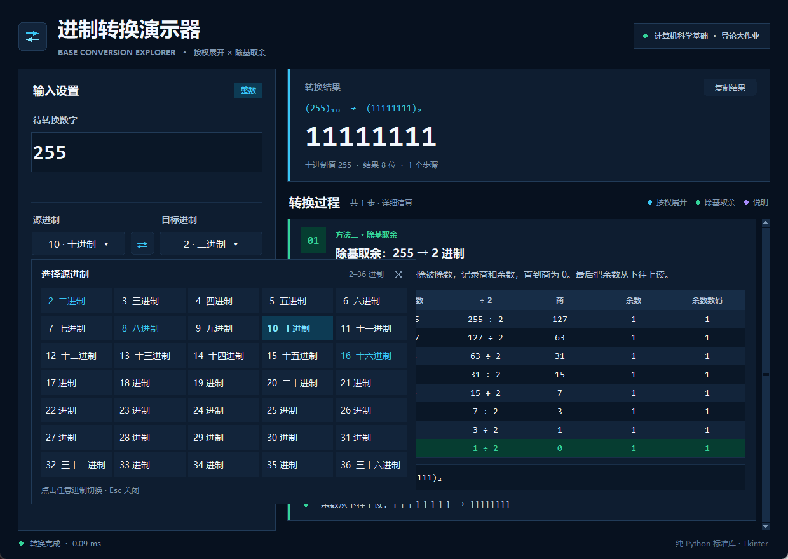

# 项目需求与设计文档：进制转换演示器

> 课程：计算机科学基础（导论）
> 项目类型：计算机基础概念可视化程序
> 文档版本：v1.0
> 说明：本文档由项目实现整理而来，团队提交前请补充成员信息与真实协作记录。

---

## 1. 项目概述

### 1.1 项目背景

进位制是计算机科学的基础概念。课堂教学中，十进制、二进制、八进制、十六进制之间的转换通常以板书或静态示例呈现，初学者容易只记住结论，而不理解「按权展开」与「除基取余」的过程。

本项目使用 **Python + Tkinter** 开发一个桌面可视化演示器，把进制转换的中间步骤以表格、公式和颜色标识呈现出来，帮助使用者观察每一步的数码、权值、商与余数。

### 1.2 项目目标

- 支持 **2–36 进制**任意整数互转，覆盖常见的二、八、十、十六进制。
- 清晰展示两类基本算法：**按权展开**与**除基取余**。
- 对非法输入给出可理解的错误提示。
- 保持零第三方依赖，方便在机房或任意 Python 环境中运行。
- 通过模块化设计，使核心算法可以脱离 GUI 单独测试。

---

## 2. 需求分析

### 2.1 功能需求

| 编号 | 功能 | 详细说明 | 优先级 |
| --- | --- | --- | --- |
| F1 | 进制选择 | 源进制与目标进制可在 2–36 之间选择 | 高 |
| F2 | 数值输入 | 支持 0–9、A–Z 数码，允许正负号、空格、下划线与 `0b`/`0o`/`0x` 前缀 | 高 |
| F3 | 转换计算 | 正确完成任意两种进制之间的整数转换 | 高 |
| F4 | 过程展示 | 非十进制转十进制展示按权展开表；十进制转非十进制展示除基取余表 | 高 |
| F5 | 多步路线 | 两个非十进制互转时，展示「先转十进制再转目标进制」的路线 | 中 |
| F6 | 快捷示例 | 提供 4 组一键示例，方便课堂演示 | 中 |
| F7 | 复制结果 | 一键复制目标进制结果到剪贴板 | 低 |
| F8 | 实时预览 | 输入合法内容后自动更新结果 | 中 |
| F9 | 错误提示 | 指出非法字符的位置及该进制允许的数码范围 | 高 |

### 2.2 非功能需求

- **易用性**：单窗口操作，输入、进制选择、结果、步骤在同一界面完成。
- **可读性**：使用深色主题、等宽字体展示数字、不同颜色区分方法类型。
- **健壮性**：对空输入、非法进制、非法数码、超长输入给出明确提示，不崩溃。
- **可维护性**：计算逻辑与界面逻辑分离，核心函数有类型注解和文档字符串。
- **可测试性**：核心算法提供单元测试，不依赖图形界面。
- **兼容性**：Windows 10/11 官方 Python 3.10+ 可直接运行，无需 pip 安装。

---

## 3. 系统设计

### 3.1 总体架构

```text
┌─────────────────────────────────────────────┐
│                  main.py                    │
│        程序入口 / 高 DPI 适配 / 启动        │
└──────────────────────┬──────────────────────┘
                       │
┌──────────────────────▼──────────────────────┐
│              base_converter/app.py          │
│   主窗口、输入区、结果卡、步骤卡、事件响应  │
└───────────────┬─────────────────────────────┘
                │ 调用
┌───────────────▼─────────────────────────────┐
│           base_converter/converter.py       │
│  解析输入 → 计算数值 → 生成 Step 列表       │
│             （不依赖 Tkinter）              │
└─────────────────────────────────────────────┘
```

### 3.2 模块划分

| 模块 | 职责 |
| --- | --- |
| `main.py` | 设置 DPI、创建主窗口、进入事件循环 |
| `base_converter/converter.py` | 进制校验、数字解析、进制转换、步骤数据生成 |
| `base_converter/app.py` | 界面布局、交互事件、结果与步骤渲染、错误展示 |
| `base_converter/theme.py` | 颜色、字体、步骤类型配色 |
| `base_converter/widgets.py` | 圆角按钮、可滚动容器等通用控件 |
| `tests/test_converter.py` | 核心逻辑单元测试 |

### 3.3 数据流

1. 用户在输入框输入数字，选择源进制和目标进制。
2. `app.py` 读取界面状态，调用 `build_conversion(text, source_base, target_base)`。
3. `converter.py` 校验并解析输入，得到带符号的十进制整数。
4. 根据源/目标进制生成若干 `Step` 对象：
   - 源进制 ≠ 10：生成按权展开步骤；
   - 目标进制 ≠ 10：生成除基取余步骤；
   - 两者都 ≠ 10：额外生成一条「转换路线」说明。
5. `app.py` 把结果与步骤渲染成结果卡和步骤卡片；出错时渲染错误卡。

### 3.4 关键数据结构

```python
@dataclass(frozen=True)
class Step:
    kicker: str          # 步骤类型标签，如“方法一 · 按权展开”
    title: str           # 步骤标题
    description: str     # 方法说明
    kind: str            # info / expand / divide
    headers: tuple[str, ...]
    rows: tuple[tuple[str, ...], ...]
    footer: str          # 结论或读取顺序
    formula: str         # 推导公式

@dataclass(frozen=True)
class ConversionResult:
    value: int           # 带符号十进制值
    source_base: int
    target_base: int
    target_digits: str
    steps: tuple[Step, ...]
```

### 3.5 可执行文件打包

使用 **PyInstaller 6.x** 将程序打包为 Windows 64 位可执行文件：

- 采用 **onedir + windowed** 模式：启动稳定，不依赖运行时解压临时目录；
- 通过自定义 manifest 声明 **PerMonitorV2** DPI 感知，避免高缩放屏幕下界面模糊；
- 使用 `assets/app.ico` 设置程序图标，并写入版本信息；
- 发布时 `进制转换演示器.exe` 与 `_internal` 文件夹必须保持同级、一起复制。

---

## 4. 界面设计

### 4.1 布局


界面分为三个区域：

1. **顶部品牌区**：标题、英文副标题、课程信息徽章。
2. **左侧输入区**：数字输入框、源/目标进制选择按钮、交换按钮、转换按钮、快捷示例、进制速查。
3. **右侧结果区**：结果卡（表达式、大号结果、十进制值、位数、步骤数）＋ 可滚动的步骤时间线。

点击「源进制」或「目标进制」按钮时，会弹出一个 5 列的 2–36 进制选择面板，当前进制高亮显示：



### 4.2 交互流程

```text
启动程序
   │
   ▼
自动展示示例：255（十进制）→ 二进制
   │
   ├── 输入数字并选择进制 ──▶ 点击“开始转换”或按 Enter
   │                                │
   │                    ┌───────────┴───────────┐
   │                    ▼                       ▼
   │                 输入合法               输入非法
   │                    │                       │
   │             渲染结果与步骤            显示错误卡片
   │
   ├── 点击快捷示例 ──▶ 自动填入数字与进制并转换
   └── 点击“⇄” ──▶ 结果回填到输入框，交换进制并验证往返
```

### 4.3 视觉规范

- 背景：深海军蓝 `#07111F`，卡片：`#0E1D30`。
- 主色：青色 `#39C6F4`；按权展开用青色，除基取余用绿色，方法说明用紫色。
- 数字与表格：等宽字体；界面文字：微软雅黑 UI。
- 步骤卡上的左侧色条与步骤编号颜色同步，帮助快速识别步骤类型。

---

## 5. 核心算法

### 5.1 按权展开

对于 `base` 进制的数码串 `d_{n-1} ... d_1 d_0`：

```text
value = Σ (digit_i × base^i),  i = 0 ... n-1
```

以 `(FF)₁₆` 为例：

```text
(FF)₁₆ = 15 × 16¹ + 15 × 16⁰ = 240 + 15 = 255
```

**复杂度**：O(n)，n 为输入位数。

### 5.2 除基取余

```text
while n > 0:
    q, r = divmod(n, base)
    digit = DIGITS[r]
    n = q
result = reverse(digits)
```

**复杂度**：O(log_base(value)) 次循环，每次除法在 Python 大整数上为 O(n)。

### 5.3 任意进制互转

```text
source_digits ──按权展开──▶ decimal ──除基取余──▶ target_digits
```

两个步骤之间通过 `ConversionResult` 传递十进制值，保证中间结果精确，不经过浮点数。

### 5.4 边界处理

- `0` 转换为任意进制结果均为 `0`。
- 负号单独提取，绝对值参与运算，结果再加回负号。
- 前导零会被去除，例如 `00ff` 规范化为 `FF`。
- 同进制输入直接返回规范化数码，并提示无需换算。

---

## 6. 异常处理

| 场景 | 处理方式 |
| --- | --- |
| 输入为空 | 提示“请输入一个数字” |
| 进制不在 2–36 | 提示允许的进制范围 |
| 非法数码 | 提示字符、位置及该进制可用数码 |
| 只有正负号 | 提示正负号后还需要数字 |
| 超过 96 位 | 提示数字过长，避免步骤失去可读性 |
| 小数输入 | 当前版本不支持，提示只演示整数 |

所有错误通过 `ConversionError` 统一抛出，界面捕获后显示在输入框下方，并在步骤区显示错误卡片。

---

## 7. 测试方案

### 7.1 单元测试

执行：

```bash
python -m unittest discover -s tests -v
```

覆盖范围：

| 测试类 | 内容 |
| --- | --- |
| `ParseNumberTests` | 常见进制、大小写、空格、前缀、正负号、前导零、非法字符、超长输入 |
| `IntToBaseTests` | 0、负数、常见值、大整数、36 进制 |
| `BuildConversionTests` | 十进制转二进制、十六进制转十进制、多步骤路线、同进制、零、负数、随机往返 |

### 7.2 手工测试

- 启动后默认示例是否正确显示 `11111111`。
- 点击四个快捷示例，结果是否分别为 `11111111`、`255`、`AA`、`1K8`。
- 输入 `2` 且源进制为 2，是否显示错误提示。
- 点击交换按钮，是否完成往返验证并回到 `255`。
- 点击复制结果，剪贴板内容是否正确。
- 缩放窗口至最小尺寸，布局是否仍然可读。

---

## 8. 团队分工

> 本项目按 5 人团队分工；下表与 [README.md](README.md#-五人团队分工) 保持同步。
> 姓名、学号请在提交前替换为实际成员，工作量占比可根据实际贡献微调。

| 成员 | 角色 | 负责内容 | 主要文件 | Git 分支 | 占比 |
| --- | --- | --- | --- | --- | --- |
| 成员 1（姓名待填） | 项目负责人 / 文档与 Git | 需求分析、文档整合、仓库管理、PR 审查、冲突解决 | `README.md`、`Project_Requirements_and_Design.md` | `docs/requirements` | 20% |
| 成员 2（姓名待填） | 核心算法 | 进制解析、按权展开、除基取余、步骤数据生成 | `base_converter/converter.py` | `feature/core-algorithm` | 20% |
| 成员 3（姓名待填） | 界面与交互 | Tkinter 布局、结果卡、步骤卡片、事件响应 | `base_converter/app.py`、`theme.py`、`widgets.py` | `feature/gui` | 25% |
| 成员 4（姓名待填） | 测试与质量 | 单元测试、边界与随机测试、Bug 定位与修复 | `tests/test_converter.py` | `test/quality` | 15% |
| 成员 5（姓名待填） | 打包与演示 | EXE 打包、图标与 manifest、截图、运行说明、课堂演示 | `assets/`、`screenshots/`、`进制转换演示器.exe` | `build/release` | 20% |

### 8.1 Git 协作流程

1. 从最新的 `main` 创建个人功能分支，例如 `feature/gui`。
2. 在功能分支上完成修改，使用清晰的提交信息并推送到 GitHub。
3. 发起 Pull Request，至少由另一名成员完成 Code Review 后合并。
4. 合并后删除已完成的远程功能分支；`main` 始终保持可运行。
5. 至少完成一次真实冲突演练：两人修改同一段文档或同一参数，在本地解决冲突后再合并，并保留相关记录。

---

## 9. 后续可扩展方向

- **小数进制转换**：增加乘基取整步骤，支持有限小数与循环小数标注。
- **补码演示**：新增 8/16/32 位补码转换与加减法溢出判断。
- **ASCII 与奇偶校验**：将本项目扩展为完整的编码演示工具。
- **步骤动画**：逐行高亮当前计算行，支持自动播放。
- **导出功能**：把结果与步骤导出为 Markdown 或图片，方便写实验报告。

---

## 10. 参考资料

- 课程讲义：进位制与数制转换相关内容。
- Python 官方文档：`tkinter`、`dataclasses`、`unittest`。
- 项目源代码与测试：见本目录 `main.py`、`base_converter/`、`tests/`。
