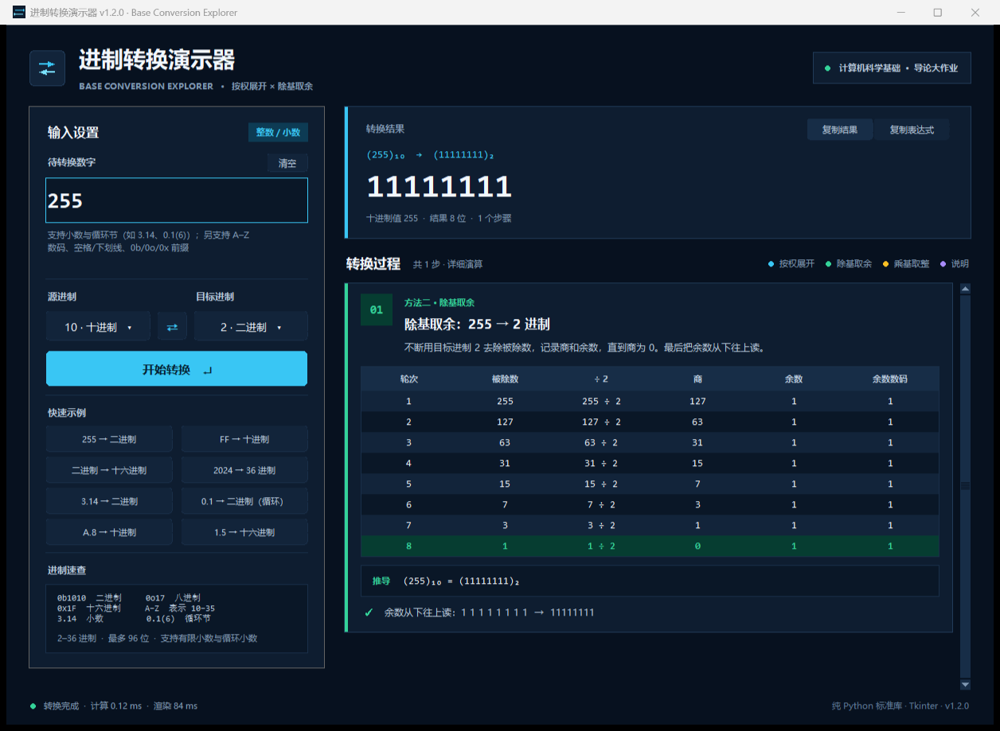
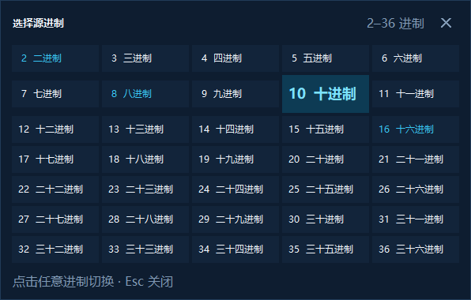
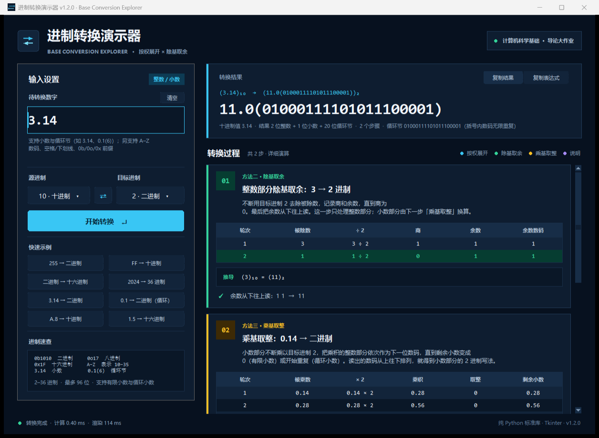
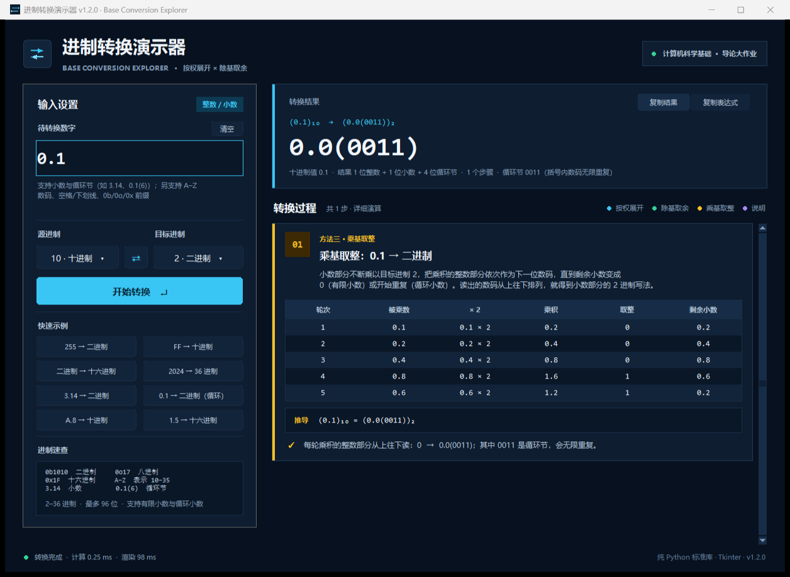
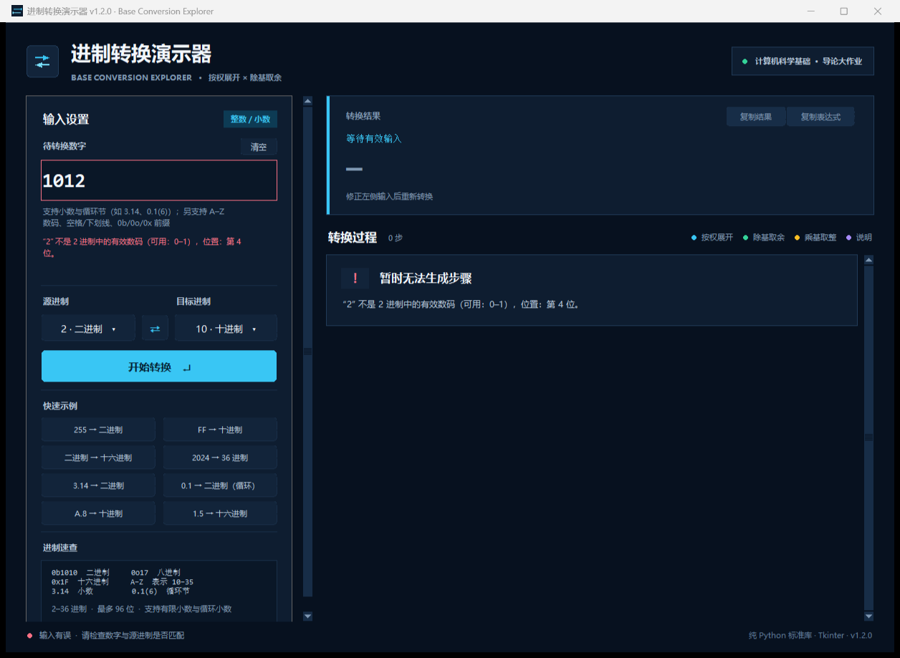
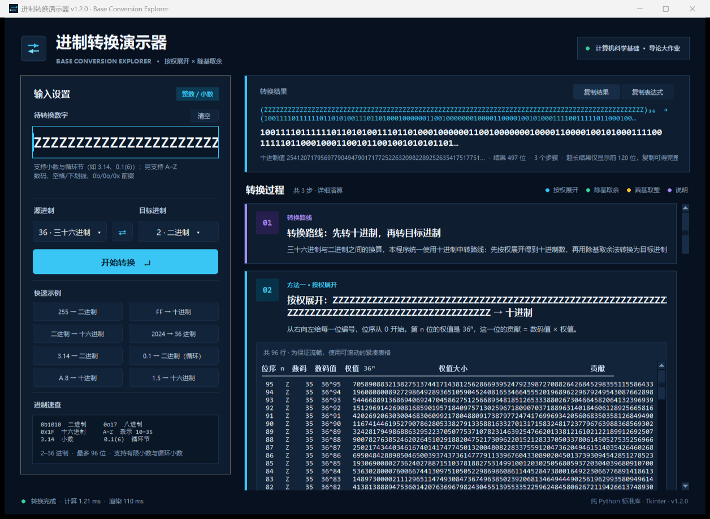

# 项目需求与设计文档：进制转换演示器

> 课程：计算机科学基础（导论）
> 项目类型：计算机基础概念可视化程序
> 文档版本：v1.2（对应程序 v1.2.0）
> 说明：本文档由项目实现整理而来，团队提交前请补充成员信息与真实协作记录。

---

## 1. 项目概述

### 1.1 项目背景

进位制是计算机科学的基础概念。课堂教学中，十进制、二进制、八进制、十六进制之间的转换通常以板书或静态示例呈现，初学者容易只记住结论，而不理解「按权展开」与「除基取余」的过程。

本项目使用 **Python + Tkinter** 开发一个桌面可视化演示器，把进制转换的中间步骤以表格、公式和颜色标识呈现出来，帮助使用者观察每一步的数码、权值、商与余数。

### 1.2 项目目标

- 支持 **2–36 进制**任意整数与小数互转，覆盖常见的二、八、十、十六进制。
- 清晰展示三类基本算法：**按权展开**、**除基取余**与**乘基取整**，并标注有限小数与循环小数。
- 对非法输入给出可理解、可定位的错误提示。
- 保持零第三方依赖，方便在机房或任意 Python 环境中运行。
- 通过模块化设计，使核心算法可以脱离 GUI 单独测试。
- 适应常见教室投影与笔记本的小屏环境，并在输入较长时保持流畅。

### 1.3 版本说明

- **v1.0**：完成 2–36 进制整数互转、步骤可视化与 Windows 打包的初始版本。
- **v1.1.0**：在 v1.0 基础上改进输入兼容性与反馈、键盘焦点、小屏布局与超长输入的渲染性能，并补齐打包配置和文档。用户可见的变更清单见 [CHANGELOG.md](CHANGELOG.md)。
- **v1.2.0**：新增小数与循环小数转换，加入「乘基取整」步骤、循环节标注与精确有理数运算；输入支持小数点、循环节括号，界面新增小数快捷示例与乘基取整配色。

---

## 2. 需求分析

### 2.1 功能需求

| 编号 | 功能 | 详细说明 | 优先级 |
| --- | --- | --- | --- |
| F1 | 进制选择 | 源进制与目标进制可在 2–36 之间选择；所有进制均有中文名称 | 高 |
| F2 | 数值输入 | 支持 0–9、A–Z 数码、正负号、空格、下划线与 `0b`/`0o`/`0x` 前缀；支持小数点（`.`、`。`、`·`）与循环节括号 `0.1(6)`；输入先做 NFKC 规范化，接受全角字符；前缀仅在匹配源进制时生效，不匹配时提示切换源进制或去掉前缀；整数、小数与循环节合计最多 96 位数码 | 高 |
| F3 | 转换计算 | 正确完成任意两种进制之间的整数与小数转换，结果保留符号；小数使用精确有理数计算，循环小数标注循环节 | 高 |
| F4 | 过程展示 | 非十进制转十进制展示按权展开表（小数位序从 −1 开始）；十进制转非十进制展示除基取余表；小数部分展示乘基取整表；负数步骤标注「绝对值」并说明补回负号 | 高 |
| F5 | 多步路线 | 两个非十进制互转时，展示「先转十进制再转目标进制」的路线；2 的幂进制之间说明存在分组速算方法但程序仍采用十进制路线 | 中 |
| F6 | 快捷示例 | 提供 8 组一键示例（整数 4 组、小数与循环小数 4 组），方便课堂演示 | 中 |
| F7 | 复制 | 一键复制目标进制结果；新增「复制表达式」，复制形如 `(255)₁₀ → (FF)₁₆` 的完整表达式，并支持 `Ctrl + Shift + C` | 低 |
| F8 | 实时预览 | 输入停止约 0.4 秒后自动更新结果；输入非法时立即显示错误卡片与红色输入框，禁用复制按钮，不保留旧结果 | 中 |
| F9 | 错误提示 | 指出非法数码在原始输入文本中的位置（空格、下划线、正负号、前缀计入）及该进制允许的数码范围；对前缀不匹配、小数点重复、循环节括号不完整、截断结果被当作输入等情况给出明确提示 | 高 |
| F10 | 清空 | 「清空」按钮或输入框聚焦时按 `Esc`，清空输入、结果与步骤，并恢复初始提示 | 中 |
| F11 | 键盘与焦点 | 转换、复制、交换、选择进制后焦点回到输入框；Canvas 按钮有可见焦点环，复制按钮进入 Tab 顺序；`Enter`/`F5` 在程序窗口内全局生效，但进制选择面板打开时由面板处理 | 中 |
| F12 | 自适应布局与超长输入 | 窗口按桌面可用区域自动调整，左侧输入区可滚动；步骤超过 40 行或窗口较窄时使用可滚动紧凑文本表格；结果卡超长时截断显示但保留完整复制值 | 中 |

### 2.2 非功能需求

- **易用性**：单窗口操作，输入、进制选择、结果、步骤在同一界面完成；小屏下各区域可独立滚动。
- **可读性**：使用深色主题、等宽字体展示数字、不同颜色区分方法类型；键盘操作有可见焦点反馈。
- **健壮性**：对空输入、非法进制、非法数码、前缀不匹配、小数格式错误、超长输入给出明确提示，不崩溃；未处理异常写入日志并弹窗提示。
- **可维护性**：计算逻辑与界面逻辑分离，核心函数有类型注解和文档字符串；界面模块惰性导入，便于无图形环境测试。
- **可测试性**：核心算法提供单元测试，不依赖图形界面；界面交互提供可自动跳过的回归测试。
- **兼容性**：Windows 10/11 官方 Python 3.10+ 可直接运行，无需 pip 安装；推荐可用桌面区域不小于约 **1000×640**，1366×768、1024×768 等小屏可正常使用。
- **性能**：96 位输入（最坏情形为三十六进制转二进制）的转换与渲染通常应在 1 秒内完成，不出现界面冻结。
- **零依赖**：程序运行时只使用 Python 标准库；PyInstaller 仅打包时需要。

---

## 3. 系统设计

### 3.1 总体架构

```text
┌─────────────────────────────────────────────┐
│                  main.py                    │
│   程序入口 / 高 DPI 适配 / 启动失败提示      │
└──────────────────────┬──────────────────────┘
                       │
┌──────────────────────▼──────────────────────┐
│              base_converter/app.py          │
│  主窗口、滚动布局、实时预览、结果卡、步骤卡  │
│         焦点管理、错误展示与日志            │
└───────────────┬─────────────────────────────┘
                │ 调用
┌───────────────▼─────────────────────────────┐
│           base_converter/converter.py       │
│  解析输入 → 计算数值 → 生成 Step 列表       │
│             （不依赖 Tkinter）              │
└─────────────────────────────────────────────┘
         ▲                         ▲
         │                         │
   theme.py / widgets.py     tests/test_*.py
```

### 3.2 模块划分

| 模块 | 职责 |
| --- | --- |
| `main.py` | 设置 Windows DPI 感知、导入主界面、启动失败时弹窗提示 |
| `base_converter/__init__.py` | 包入口，使用模块级 `__getattr__` 惰性导出 `BaseConverterApp`，避免导入核心模块时加载 Tkinter |
| `base_converter/converter.py` | 进制校验、NFKC 输入解析、前缀处理、小数/循环节解析、精确有理数转换、步骤数据生成 |
| `base_converter/app.py` | 界面布局、实时预览、交互事件、结果与步骤渲染、错误展示、焦点管理、未处理异常日志 |
| `base_converter/theme.py` | 颜色、字体、步骤类型配色（含乘基取整）与字体回退 |
| `base_converter/widgets.py` | 圆角按钮、焦点环、2–36 进制选择面板、可滚动容器与跨平台滚轮处理 |
| `tests/test_converter.py` | 核心逻辑单元测试（106 个用例） |
| `tests/test_app_ui.py` | 界面交互回归测试（9 个用例，无显示环境自动跳过） |
| `build/` | PyInstaller spec、manifest、版本信息、一键打包脚本与打包说明 |

### 3.3 数据流

1. 程序启动时先展示示例「255（十进制）→ 二进制」；启动失败由 `main.py` 弹出可见错误对话框（无控制台也可看到）。
2. 用户输入时，`app.py` 在每次按键后重新计时约 380 ms，触发实时预览；预览与「开始转换」共用 `build_conversion(text, source_base, target_base)`。
3. `converter.py` 先做 NFKC 规范化并把 `。`、`·` 归一为小数点，再校验空输入、正负号、前缀、小数点、循环节括号、位数与数码，使用 `Fraction` 得到带符号的精确十进制值。
4. 根据源/目标进制生成若干 `Step` 对象：
   - 源进制 ≠ 10 且输入不含循环节：生成按权展开步骤（整数部分位序 ≥ 0，小数部分位序 < 0）；
   - 输入含循环节：生成「循环小数展开」步骤，用等比级数说明如何得到精确分数；
   - 目标进制 ≠ 10：整数部分生成除基取余步骤，小数部分生成乘基取整步骤；
   - 两者都 ≠ 10：额外生成一条「转换路线」说明；
   - 两者相同：生成「无需换算」说明。
5. 转换成功时，`app.py` 渲染结果卡与步骤卡片，启用复制按钮，并把焦点还给输入框；失败时显示错误卡片、红色输入框，清空旧结果并禁用复制按钮。

### 3.4 关键数据结构

```python
@dataclass(frozen=True)
class Step:
    kicker: str          # 步骤类型标签，如“方法三 · 乘基取整”
    title: str           # 步骤标题
    description: str     # 方法说明
    kind: str            # info / expand / divide / multiply
    headers: tuple[str, ...]
    rows: tuple[tuple[str, ...], ...]
    footer: str          # 结论或读取顺序
    formula: str         # 推导公式

@dataclass(frozen=True)
class ParsedNumber:
    raw: str
    base: int
    value: Fraction     # 精确有理数值（含符号）
    negative: bool
    normalized: str     # 规范化写法，可能含小数点和循环节括号
    integer_digits: str
    fraction_digits: str
    repeat_digits: str
    fraction_truncated: bool

@dataclass(frozen=True)
class FractionExpansion:
    digits: str         # 循环节之前（有尽小数则为全部）的数码
    repeat: str         # 循环节，空串表示有尽小数
    truncated: bool     # 小数部分是否在 64 位内未结束而截断
    steps: tuple[...]   # 乘基取整逐轮演算

@dataclass(frozen=True)
class ConversionResult:
    raw: str             # 原始输入文本
    source_base: int
    target_base: int
    normalized: str      # 规范化后的带符号文本（不含前缀/空格/下划线）
    source_digits: str   # 源进制整数部分数码串（不含符号）
    target_digits: str   # 目标进制结果（含负号、小数点与循环节）
    value: Fraction      # 带符号精确值
    steps: tuple[Step, ...]
    integer_value: int
    fraction_value: Fraction
    target_integer_digits: str
    target_fraction_digits: str
    target_repeat_digits: str
    target_truncated: bool

    # 便捷属性：is_negative / is_fraction / is_repeating / source_name /
    # target_name / result_text / source_text / decimal_text
    # expression() 返回 (0.1(6))₁₀ → (0.2(A))₁₆
```

### 3.5 可执行文件打包

使用 **PyInstaller 6.x** 将程序打包为 Windows 64 位可执行文件，构建配置已纳入仓库：

- 采用 **onedir + windowed** 模式：启动稳定，不依赖运行时解压临时目录，无控制台窗口；
- 通过 `build/app.manifest` 声明 **PerMonitorV2** DPI 感知、Windows 10/11 兼容性与 `asInvoker` 权限，避免高缩放屏幕下界面模糊；
- `build/version_info.txt` 写入版本号 **1.2.0**，使用 `assets/app.ico` 设置程序图标；
- 从源码运行时，`main.py` 调用 `SetProcessDpiAwareness(1)`（失败时回退 `SetProcessDPIAware()`）；打包后的 EXE 由 manifest 声明 PerMonitorV2。两条启动路径的 DPI 策略不同，文档与排查时需区分；
- 重新打包可执行 `build/build.ps1` 或 `py -m PyInstaller --noconfirm --clean build/BaseConverterDir.spec`，产物输出到 `build/dist/BaseConverterDir/`；
- 发布时 `进制转换演示器.exe` 与 `_internal` 文件夹必须保持同级、一起复制。

---

## 4. 界面设计

### 4.1 布局



界面分为三个区域：

1. **顶部品牌区**：标题、英文副标题、课程信息徽章；窗口标题栏与页脚显示版本号 v1.2.0。
2. **左侧输入区**：数字输入框、清空按钮、输入提示与错误提示、源/目标进制选择按钮、交换按钮、转换按钮、快捷示例、进制速查。该区域放在可滚动容器中，内容适配时滚动条自动隐藏。
3. **右侧结果区**：结果卡（表达式、大号结果、十进制值、结果位数、步骤数）＋ 可滚动的步骤时间线；底部状态栏显示「计算 / 渲染」耗时与操作反馈。

窗口默认基准尺寸为 **1240×880**，启动时按桌面可用区域自动收缩并居中。窗口最小尺寸取 `min(1000, 实际宽) × min(640, 实际高)`，因此可用区域不小于约 1000×640 的屏幕可以完整使用；更小的桌面会自动进一步缩小，且左侧输入区可以滚动。

在高 DPI 屏幕上，Tk 缩放值被限制在 `[1.333, 2.0]` 之间，窗口基准尺寸根据缩放比例最多放大 **1.35 倍**；低缩放环境下保持原始尺寸。

点击「源进制」或「目标进制」按钮时，会弹出一个 5 列的 2–36 进制选择面板，当前进制高亮显示：



### 4.2 交互流程

```text
启动程序
   │
   ▼
自动展示示例：255（十进制）→ 二进制
   │
   ├── 输入/修改数字 ──▶ 停止输入约 0.4 秒 ──▶ 自动预览
   │                                │
   │                    ┌───────────┴───────────┐
   │                    ▼                       ▼
   │                 输入合法               输入非法
   │                    │                       │
   │             更新结果与步骤          显示错误卡片、红框
   │             启用复制按钮            清空旧结果、禁用复制
   │
   ├── 点击“开始转换”或按 Enter ──▶ 立即转换
   ├── 点击快捷示例 ──▶ 自动填入数字与进制并转换
   ├── 点击“⇄” ──▶ 输入有效时结果回填到输入框，交换进制并验证往返
   ├── 点击“清空”/按 Esc ──▶ 清空输入、结果与步骤
   └── 点击“复制结果”/“复制表达式” ──▶ 写入剪贴板，焦点回到输入框
```

交互细节：

- 转换、复制、交换、选择进制后，焦点自动回到输入框；Canvas 按钮带可见焦点环，复制按钮在启用后进入 Tab 顺序。
- `Enter` / `F5` 在程序窗口内全局生效；进制选择面板打开时，`Enter` / `F5` 由面板处理为「确认当前进制并重新转换」，`Esc` 关闭面板并把焦点交还按钮。
- 一个进制选择面板打开时，直接点击另一个进制按钮即可关闭当前面板并打开另一个，不需要点击两次。
- 步骤区与左侧输入区的鼠标滚轮在 Windows 与 Linux 下均可滚动，非 120 整数倍的滚轮增量也能响应。
- 未处理的界面回调异常会写入 `%TEMP%\进制转换演示器.log` 并弹出错误对话框；启动失败会弹窗提示，不依赖控制台。

### 4.3 视觉规范

- 背景：深海军蓝 `#07111F`，卡片：`#0E1D30`。
- 主色：青色 `#39C6F4`；按权展开用青色，除基取余用绿色 `#34D399`，乘基取整用琥珀色 `#FBBF24`，方法说明用紫色 `#A78BFA`。
- 错误状态使用红色 `#FB7185`：输入框红色边框、错误文字与错误卡片。
- 数字与表格：等宽字体（Consolas 或回退字体）；界面文字：微软雅黑 UI 或回退字体。
- 步骤卡上的左侧色条与步骤编号颜色同步，帮助快速识别步骤类型。

### 4.4 小数、小屏、错误与超长输入



带小数的输入会同时生成「除基取余（整数部分）」与「乘基取整（小数部分）」步骤；目标进制出现循环节时，结果用括号标注，例如 `(0.1)₁₀ = (0.0(0011))₂`。





实时预览发现输入非法时，输入框立即变红，左侧显示错误原因和位置，右侧结果卡回到「等待有效输入」，步骤区显示错误说明，复制按钮禁用，不再展示上一次的旧结果。


在 1024×700 的窗口中，窗口自动缩小，左侧输入区出现可滚动条（内容放得下时自动隐藏），转换按钮和快捷示例可通过滚动查看，不再被裁切。



超长输入时，结果卡只显示前 120 位左右并以 `…` 标记，附注“超长结果仅显示前 120 位，复制可得完整值”；完整结果仍保留在内存中供复制。步骤表格超过 40 行或窗口较窄时改用单个只读 `Text` 控件呈现，可滚动查看全部数据。

---

## 5. 核心算法

### 5.1 按权展开

对于 `base` 进制的数码串 `d_{n-1} ... d_1 d_0`：

```text
value = Σ (digit_i × base^i),  i = n-1 ... 0, -1 ... -m
```

以 `(FF)₁₆` 为例：

```text
(FF)₁₆ = 15 × 16¹ + 15 × 16⁰ = 240 + 15 = 255
```

以 `(0.101)₂` 为例，小数部分从左向右编号为 −1、−2、−3：

```text
(0.101)₂ = 1 × 2⁻¹ + 0 × 2⁻² + 1 × 2⁻³
         = 0.5 + 0 + 0.125 = 0.625
```

计算时使用 `Fraction` 表示 2⁻¹ 等负位权，因此 `1/16` 这类值不会被浮点误差污染。

**负数处理**：先取绝对值参与展开，步骤标题、说明与公式都标注「绝对值」，并在结论中说明补回负号。例如 `(-FF)₁₆ → 十进制` 的绝对值展开为 `15 × 16¹ + 15 × 16⁰ = 255`，最终结果为 `-255`。

**复杂度**：O(n)，n 为输入位数。

### 5.2 除基取余

```text
while n > 0:
    q, r = divmod(n, base)
    digit = DIGITS[r]
    n = q
result = reverse(digits)
```

**负数处理**：同样只对绝对值做除法，步骤中标注「绝对值」，最后补回负号；结果的符号与原输入一致。例如 `(-255)₁₀ → 十六进制` 的竖式使用 `255`，结果为 `-FF`。

**复杂度**：O(log_base(value)) 次循环，每次除法在 Python 大整数上为 O(n)。

### 5.3 乘基取整与循环小数

小数部分 `f`（0 < f < 1）换算到目标进制的算法：

```text
while f != 0 and 未发现循环:
    f × base = 整数部分 d + 余数 r
    输出数码 D[d]
    f = r
```

以 `(0.625)₁₀ → 二进制` 为例：

```text
0.625 × 2 = 1.25  → 1
0.25  × 2 = 0.5   → 0
0.5   × 2 = 1.0   → 1
0.0   → 结束
(0.625)₁₀ = (0.101)₂
```

循环小数通过记录出现过的「剩余小数」识别：如果某一轮的余数与之前相同，从该位置开始就会无限重复。例如 `(0.1)₁₀ → 二进制`：

```text
0.1 × 2 = 0.2  → 0，余 0.2
0.2 × 2 = 0.4  → 0，余 0.4
0.4 × 2 = 0.8  → 0，余 0.8
0.8 × 2 = 1.6  → 1，余 0.6
0.6 × 2 = 1.2  → 1，余 0.2   ← 余数 0.2 已出现过，开始循环
(0.1)₁₀ = (0.0(0011))₂
```

- 结果用 `pre(cycle)` 表示：`pre` 是不循环的小数部分，`cycle` 是循环节；
- 循环节最多展开 **64 位**；如果小数在 64 位内没有结束（循环节过长或有限小数很长），只保留前 64 位并以 `…` 结尾，步骤中会说明已截断；
- 输入也支持循环节写法（如 `0.1(6)`）。解析时按等比级数把循环节化为精确分数：`0.(R) = R / (base^k − 1)`，再按位置除以 `base^m`；
- 同一进制回显时直接使用规范化后的完整写法，不重新展开，避免把长循环节截断。

**复杂度**：最多 `min(循环节长度, 64)` 轮乘法；每轮在 `Fraction` 上做一次乘法与一次取整。

### 5.4 任意进制互转

```text
源进制数 ──按权展开──▶ 十进制数 ──除基取余（整数）+ 乘基取整（小数）──▶ 目标进制数
```

各步骤之间通过 `ConversionResult` 传递十进制精确值，保证中间结果不经过浮点数。

转换路线文案按进制类型区分：

- 二进制、四进制、八进制、十六进制、三十二进制等 2 的幂进制之间，**理论上存在按 3 位、4 位或 5 位二进制分组的快捷换算方法**；本程序为完整展示每一步演算，仍统一使用十进制中转路线，并在路线卡片中说明；
- 其他进制组合直接说明使用通用十进制中转路线；
- 输入为负数时，路线说明还会补充「整数部分与小数部分都只对绝对值演算，最后统一补回负号」（整数输入时表述为“两种方法”）。

### 5.5 边界与超长输入处理

- `0` 转换为任意进制结果均为 `0`；`0.000` 这类输入会规范化成 `0`。
- 负号单独提取，绝对值参与按权展开、除基取余与乘基取整，结果再加回负号；同一进制转换时，公式使用带符号的规范化文本（如 `(-FF)₁₆ = (-FF)₁₆`）。
- 前导零和末尾多余的零会被去除，例如 `00ff` 规范化为 `FF`、`0.2500` 规范化为 `0.25`。
- 循环节写法会规范化：`0.1(0)` 化为 `0.1`，`0.(9)₁₀` 与 `0.(1)₂` 会正确进位为整数 `1`。
- 同进制输入直接返回规范化写法，并提示无需换算。
- 输入位数上限为 **96 个有效数码**（整数、小数与循环节合计）；正负号、前缀、空格、下划线、小数点与括号不计入。超过 96 位会提示“数字过长，最多支持 96 位数码，以免步骤列表失去可读性。”
- 目标进制的小数最多展开 **64 位**；在 64 位内没有结束时（循环节过长或有限小数较长）截断并显示 `…`，截断后的文本会被明确拒绝，避免把近似值当作精确输入。
- 输出位数不受 96 位限制：例如 96 个十进制 9 会得到 319 位二进制；96 位三十六进制输入（全为 `Z`）的二进制结果是 497 位。完整结果会被保留用于复制。
- 结果卡最多展示前 120 位（实现上在 117 个字符后加省略号，保证总长度不超过 120），并显示“超长结果仅显示前 120 位，复制可得完整值”。
- 步骤表格行数超过 **40 行**，或表格有 5 列以上且可用宽度小于 **520 像素**时，改用单个只读 `Text` 控件渲染可滚动紧凑表格，避免创建上千个 Label 导致界面冻结。
- 转换结果与耗时显示在状态栏；96 位三十六进制 → 二进制的极端场景实测通常小于 1 秒。

---

## 6. 异常处理

| 场景 | 处理方式 |
| --- | --- |
| 输入为空 | 提示“请输入一个数字，例如 255、3.14、FF 或 0.1(6)。” |
| 进制不在 2–36 | 提示进制必须在 2–36 之间 |
| 非法数码 | 提示字符、该进制可用数码，以及它在原始输入文本中的位置（空格、下划线、符号、前缀、小数点、括号计入） |
| 只有正负号 | 提示正负号后还需要数字 |
| 前缀与源进制不匹配 | 提示检测到的前缀、当前源进制，并建议“把源进制改为对应进制，或去掉前缀” |
| 前缀后没有数字 | 提示进制前缀后面还需要数字 |
| 超过 96 位 | 提示数字过长，避免步骤失去可读性 |
| 小数点重复 | 提示“小数点只能有一个，例如 3.14。” |
| 小数点后没有数字 | 提示“小数点后面还需要数字，例如 3.14。”或“小数点前后至少需要一位数字” |
| 循环节括号不完整/位置错误 | 提示括号要成对、写在数字末尾、括号内至少一位数码，或“循环节括号必须写在小数点之后” |
| 把截断结果的 `…` 当作输入 | 提示省略号表示截断，不能直接作为输入，并建议使用循环节括号 |
| 界面回调未处理异常 | 写入 `%TEMP%\进制转换演示器.log`，并弹出“程序内部错误”对话框 |
| 启动失败（缺少 Tkinter 或初始化异常） | 弹出可见错误对话框；Windows 下无控制台也能提示 |

所有输入错误通过 `ConversionError` 统一抛出，界面捕获后在输入框下方显示错误原因，并在步骤区显示错误卡片、禁用复制按钮、清空旧结果。

---

## 7. 测试方案

### 7.1 自动化测试

执行：

```bash
py -m unittest discover -s tests -v
```

共 **115 个测试**：`tests/test_converter.py` 106 个核心逻辑单元测试，`tests/test_app_ui.py` 9 个界面回归测试。界面测试在无显示环境会自动跳过。

| 测试文件 / 测试类 | 覆盖内容 |
| --- | --- |
| `ParseNumberTests` | 常见进制、大小写、空格、下划线、前缀、正负号、前导零、非法字符、空输入、非法进制、超长输入 |
| `IntToBaseTests` | 0、负数、常见值、大整数、36 进制 |
| `BuildConversionTests` | 十进制转二进制、十六进制转十进制、多步骤路线、同进制、零、负数、100 组随机往返、36 进制大小写 |
| `UnicodeNormalizationTests` | 全角数字、全角字母与前缀、全角空格、全角正负号 |
| `PrefixMismatchTests` | 十六进制前缀配十进制、二进制前缀配八进制等不匹配组合、大小写、全角前缀、负号后的前缀、匹配前缀正常剥离 |
| `DecimalParsingTests` | 3.14、.5、0x1.8 等小数，中文/全角小数点，循环节括号，规范化去零，小数与循环节字段，旧 `parse_number` 兼容 |
| `DecimalErrorTests` | 多个小数点、空小数、循环节括号不完整/位置错误、小数位非法数码及位置、96 位边界、截断结果不可回填 |
| `FractionHelperTests` | `expand_fraction` 的终止/循环/截断行为与参数校验，`value_to_text` 的进制与循环节写法 |
| `FractionConversionTests` | 有尽小数、循环小数、循环十进制、十六进制小数、负小数、同进制规范化、零小数、整数/小数分步、循环节往返、长循环节截断、精确值 |
| `ErrorPositionTests` | 含空格、前缀、正负号、下划线、全角字符时的错误位置 |
| `NegativeStepTests` | 同进制负号表达式、按权展开与除基取余的「绝对值」文案、转换路线的符号说明、正数步骤不含负数话术 |
| `BaseNameTests` | 2–36 进制中文名称完整、唯一、`base_name` 与结果属性正确 |
| `RouteTextTests` | 路线文案不再声称“没有直接的逐位换算规则”，2 的幂进制提及分组速算，非 2 的幂使用十进制路线 |
| `BoundaryTests` | `MAX_INPUT_DIGITS` 保持 96、96 位可用、97 位报错、带前缀的边界 |
| `RandomNonDecimalRoundTripTests` | 50 组随机非十进制 → 非十进制往返转换 |
| `LazyImportTests` | 禁用 Tkinter 时核心模块可导入、包导入不加载 Tkinter、未知属性抛 `AttributeError` |
| `PublicApiTests` | 常量、进制校验、数码提示、快捷示例结构、整数与小数结果字段 |
| `AppUiTests`（`tests/test_app_ui.py`） | 非法预览清空旧结果并禁用复制、Enter 只触发一次转换、⇄ 使用当前输入、小数循环结果预览、小数错误位置、小数往返交换、焦点回到输入框与复制按钮 Tab 顺序、清空状态、96 位输入快速渲染与结果截断 |

性能回归测试对 96 位三十六进制 → 二进制场景设置 5 秒上限（避免机器波动导致误报），当前实测通常小于 1 秒。

### 7.2 手工测试

- 启动后默认示例是否正确显示 `11111111`，标题与页脚是否显示 v1.2.0。
- 点击 8 个快捷示例，整数结果是否分别为 `11111111`、`255`、`AA`、`1K8`；小数示例是否分别得到 `11.0(01000111101011100001)`、`0.0(0011)`、`10.5`、`1.8`。
- 输入 `2` 且源进制为 2，是否显示错误提示；输入 `1010 1012`，是否提示第 9 位。
- 在十进制下输入 `0x1F`，是否提示切换源进制或去掉前缀。
- 输入 `3.14`、`0.625`、`0.1`，检查结果、循环节标注与「乘基取整」步骤是否正确。
- 输入 `0.1(6)`、`0.(3)`，检查循环小数展开公式与结果；把结果 `0.2(A)` 复制回输入框验证往返。
- 输入十进制的 `0.(9)` 或二进制的 `0.(1)`，检查是否进位为整数 `1`。
- 输入 `3.1.4`、`3.`、`0.1()`、`0.1(2)3`，检查错误提示是否具体。
- 输入 `２５５`、`３．１４`、`０ｘ１Ｆ`、含全角空格的数字，是否能正确转换。
- 输入 `-2.5` 并转为二进制，检查是否得到 `-10.1`，步骤是否标注「绝对值」与补回负号。
- 点击交换按钮，是否完成往返验证并回到原值。
- 点击「复制结果」「复制表达式」，检查剪贴板内容与焦点是否回到输入框。
- 点击「清空」或按 `Esc`，检查输入、结果、步骤与复制按钮状态是否全部复位。
- 打开进制选择面板时直接点击另一个进制按钮，是否能一次切换；面板内 `Enter`/`F5`/`Esc` 是否符合预期。
- 将窗口缩小到约 1024×700，检查左侧滚动、快捷示例与转换按钮是否仍可操作。
- 输入 96 位三十六进制数，检查结果截断、提示文案、复制完整值与渲染速度。
- 在 150%/200% 缩放下检查界面是否清晰、窗口是否在屏幕内。

---

## 8. 团队分工

> 本项目按 5 人团队分工；Git 协作约定见 [README.md](README.md) 的「Git 协作约定」小节，本节表格为团队分工的正式版本。
> 姓名、学号请在提交前替换为实际成员，工作量占比可根据实际贡献微调。

| 成员 | 角色 | 负责内容 | 主要文件 | Git 分支 | 占比 |
| --- | --- | --- | --- | --- | --- |
| 成员 1（姓名待填） | 项目负责人 / 文档与 Git | 需求分析、文档整合、仓库管理、PR 审查、冲突解决 | `README.md`、`Project_Requirements_and_Design.md`、`CHANGELOG.md` | `docs/requirements` | 20% |
| 成员 2（姓名待填） | 核心算法 | 进制解析、按权展开、除基取余、步骤数据生成 | `base_converter/converter.py` | `feature/core-algorithm` | 20% |
| 成员 3（姓名待填） | 界面与交互 | Tkinter 布局、结果卡、步骤卡片、事件响应、焦点与滚动 | `base_converter/app.py`、`theme.py`、`widgets.py` | `feature/gui` | 25% |
| 成员 4（姓名待填） | 测试与质量 | 单元测试、界面回归测试、边界与随机测试、Bug 定位与修复 | `tests/test_converter.py`、`tests/test_app_ui.py` | `test/quality` | 15% |
| 成员 5（姓名待填） | 打包与演示 | EXE 打包、图标与 manifest、版本信息、截图、运行说明、课堂演示 | `assets/`、`build/`、`screenshots/`、`进制转换演示器.exe` | `build/release` | 20% |

### 8.1 Git 协作流程

1. 从最新的 `main` 创建个人功能分支，例如 `feature/gui`。
2. 在功能分支上完成修改，使用清晰的提交信息并推送到 GitHub。
3. 发起 Pull Request，至少由另一名成员完成 Code Review 后合并。
4. 合并后删除已完成的远程功能分支；`main` 始终保持可运行。
5. 至少完成一次真实冲突演练：两人修改同一段文档或同一参数，在本地解决冲突后再合并，并保留相关记录。

---

## 9. 后续可扩展方向

- **补码演示**：新增 8/16/32 位补码转换与加减法溢出判断。
- **ASCII 与奇偶校验**：将本项目扩展为完整的编码演示工具。
- **步骤动画**：逐行高亮当前计算行，支持自动播放。
- **导出功能**：把结果与步骤导出为 Markdown 或图片，方便写实验报告。

---

## 10. 参考资料

- 课程讲义：进位制与数制转换相关内容。
- Python 官方文档：`tkinter`、`dataclasses`、`unittest`、`unicodedata`。
- 项目源代码与测试：见本目录 `main.py`、`base_converter/`、`tests/`。
- 版本变更记录：见本目录 `CHANGELOG.md`。
