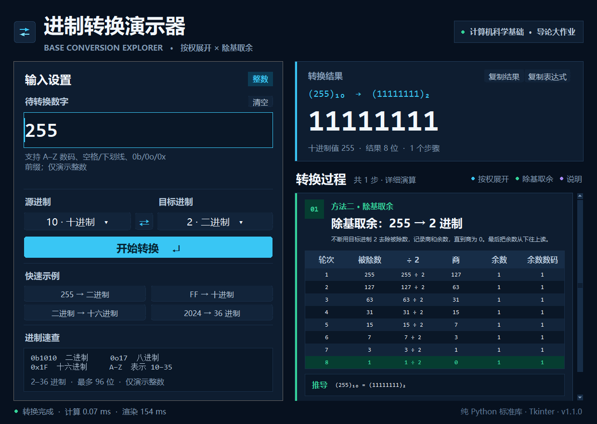
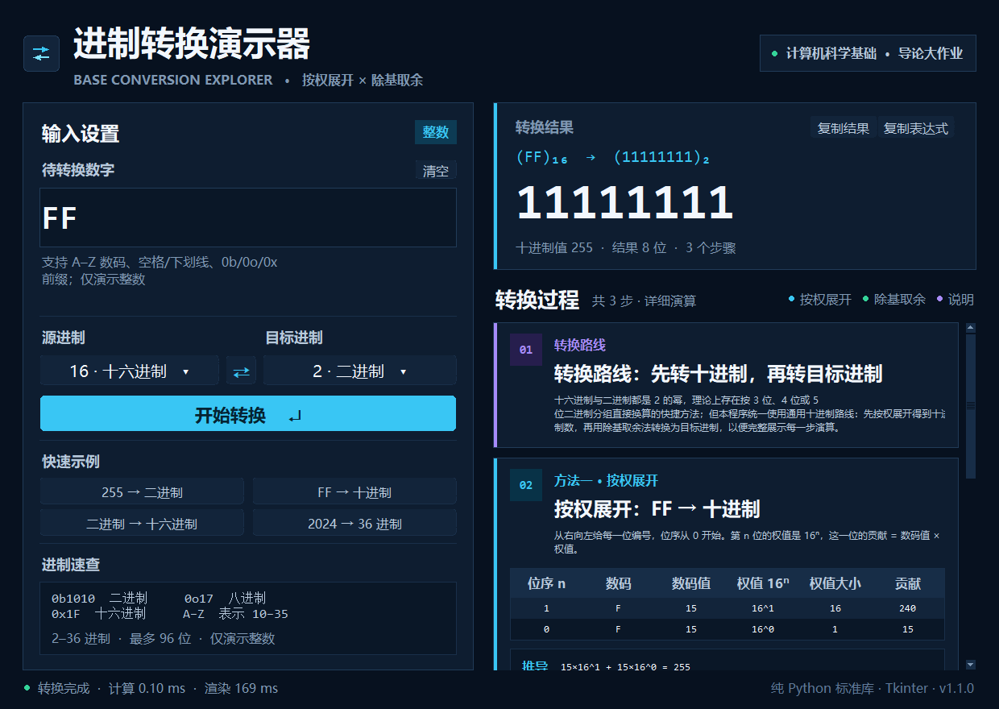

# 进制转换演示器 · Base Conversion Explorer

> 计算机科学基础导论大作业 · 进位制转换步骤可视化

一个用 **Python + Tkinter** 编写的桌面演示程序，支持 **2–36 进制**任意整数互转，并把「按权展开」与「除基取余」的完整计算过程拆成可滚动、可讲解的步骤卡片。



---

## ✨ 功能特性

| 功能 | 说明 |
| --- | --- |
| 任意进制互转 | 源进制、目标进制均可在 2–36 之间选择，支持 A–Z 表示 10–35 |
| 详细步骤 | 非十进制 → 十进制展示**按权展开表**；十进制 → 非十进制展示**除基取余表** |
| 通用路线 | 两个非十进制互转时，自动先转十进制，再转目标进制，并展示转换路线 |
| 负数支持 | 负号单独保留，竖式按绝对值演算，避免与补码概念混淆 |
| 大整数 | 基于 Python 任意精度整数，最多 96 位数码；超长数字在表格中自动换行 |
| 实时预览 | 输入合法数字后自动更新结果；按 Enter 可立即转换 |
| 便捷操作 | 交换源/目标进制、复制结果、4 组快捷示例、进制前缀识别（`0b`/`0o`/`0x`） |
| 友好报错 | 非法数码会指出出错位置和该进制允许的数码范围 |
| 开箱即用 | 提供 Windows 64 位可执行程序，目标电脑无需安装 Python |
| 零第三方依赖 | 源码只使用 Python 标准库；EXE 已内置 Python/Tk 运行库 |

---

## 🚀 快速开始

### 启动方式（推荐：直接运行 EXE）

双击项目根目录的 **`进制转换演示器.exe`** 即可启动，**不需要安装 Python**。

> `进制转换演示器.exe` 必须与同目录下的 `_internal` 文件夹一起使用，请勿只复制 exe。
> 程序未做商业代码签名，首次运行时如果 Windows SmartScreen 提示“已保护你的电脑”，
> 点击“更多信息”→“仍要运行”即可。

### 源码运行（开发调试）

环境要求：Python **3.10+**，Tkinter 默认包含在 Windows 官方 Python 中；无第三方依赖。

```bash
python main.py
```

也可以双击 `run.bat`。如果系统同时安装了多个 Python，可使用 `py -3 main.py`。
Linux 如缺少 Tkinter，可先安装 `sudo apt install python3-tk`。

---

## 📖 使用说明

1. 在左侧输入框中输入整数，例如 `255`、`FF`、`1010`。
2. 选择**源进制**与**目标进制**，点击「开始转换」或按 `Enter`。
3. 右侧会显示转换结果，以及每一步的表格和推导公式。
4. 点击「⇄」交换两种进制：程序会把当前结果带回输入框，方便验证往返转换。
5. 点击「复制结果」即可把目标进制数字复制到剪贴板。
6. 点击 4 个快捷示例可快速切换演示场景。

### 快捷键

| 按键 | 功能 |
| --- | --- |
| `Enter` | 开始转换 |
| `F5` | 重新转换 |
| `Ctrl + A` | 全选输入框内容 |

### 输入规则

- 数字可以带正负号，例如 `-255`、`+1010`。
- 允许前后空格、数字之间的空格与下划线，例如 `1010 1010`、`FF_FF`。
- 允许与源进制匹配的前缀：`0b1010`、`0o17`、`0x1F`。
- 当前版本只演示**整数**，不接受小数点。

---

## 🧠 算法说明

### 1. 按权展开：任意进制 → 十进制

从右往左给每一位编号，位序从 0 开始，第 `n` 位的权值是 `base^n`：

```text
(FF)₁₆ = 15 × 16¹ + 15 × 16⁰
       = 240 + 15
       = 255
```

界面上会逐行展示「位序、数码、数码值、权值、贡献」，最后给出求和结果。

### 2. 除基取余：十进制 → 任意进制

不断用目标进制去除被除数，记录商与余数，直到商为 0，最后把余数**从下往上**读：

```text
255 ÷ 2 = 127 ... 1   ↑
127 ÷ 2 =  63 ... 1   │
 63 ÷ 2 =  31 ... 1   │ 从下往上读
 31 ÷ 2 =  15 ... 1   │
 15 ÷ 2 =   7 ... 1   │
  7 ÷ 2 =   3 ... 1   │
  3 ÷ 2 =   1 ... 1   │
  1 ÷ 2 =   0 ... 1   ┘
```

结果：`(255)₁₀ = (11111111)₂`。

### 3. 任意进制互转

如果源进制和目标进制都不是十进制，程序按以下路线执行：

```text
源进制数  ──按权展开──▶  十进制数  ──除基取余──▶  目标进制数
```

这正是界面中「转换路线」步骤卡片所展示的内容。

---

## 🖥️ 界面导览

### 十六进制 → 二进制：三步演示



1. **转换路线**：说明为什么要先转十进制。
2. **按权展开**：把 `FF` 展开成 `255`。
3. **除基取余**：把 `255` 转成 `11111111`。

每张步骤卡片都有颜色标识：蓝色表示按权展开，绿色表示除基取余，紫色表示方法说明。

---

## 📁 项目结构

```text
进制转换演示器/
├── 进制转换演示器.exe              # 双击启动的可执行程序（Windows 64 位）
├── _internal/                       # EXE 运行所需的 Python/Tk 运行库，请勿删除
├── main.py                          # 源码入口（含 Windows 高 DPI 适配）
├── run.bat                          # 源码运行的一键启动脚本
├── README.md                        # 项目说明
├── Project_Requirements_and_Design.md  # 作业要求的需求与设计文档
├── LICENSE                          # MIT 开源协议
├── assets/
│   └── app.ico                      # 应用图标
├── base_converter/
│   ├── __init__.py
│   ├── converter.py                 # 核心算法与步骤生成（不依赖 UI）
│   ├── theme.py                     # 配色与字体
│   ├── widgets.py                   # 圆角按钮、滚动容器等自定义控件
│   └── app.py                       # Tkinter 主界面与交互逻辑
├── tests/
│   └── test_converter.py            # 核心逻辑单元测试（21 个用例）
└── screenshots/
    ├── main.png                     # 主界面截图
    └── hex_to_binary.png            # 多步骤演示截图
```

### 分层设计

- **计算与界面分离**：`converter.py` 只负责解析、计算、生成步骤数据，可在终端中独立测试。
- **步骤数据化**：每一步被封装为 `Step`，包含标题、说明、表头、表格行、推导式和结论，界面只负责渲染。
- **统一主题**：颜色、字体、间距集中在 `theme.py`，方便调整风格。
- **可测试性**：21 个单元测试覆盖进制解析、非法输入、负数、大数、随机往返转换等场景。

---

## ✅ 运行测试

在项目根目录执行：

```bash
python -m unittest discover -s tests -v
```

预期输出：

```text
Ran 21 tests in 0.0xxs

OK
```

测试内容包括：

- 常见进制解析与大小写、空格、前缀处理
- 非法数码、非法进制、空输入、超长输入
- 负数、零、同进制转换
- 大整数与 100 组随机值往返转换
- 步骤表结构与公式正确性

---

## ⚠️ 已知边界

- 当前只支持**整数**，不演示小数部分的乘基取整。
- 负数采用「符号 + 绝对值」表示，**不涉及补码**；补码属于另一个知识点。
- 单次输入最多 96 位数码。超长时表格会自动换行，但步骤会变得较长。
- 界面推荐在 1920×1080 及以上分辨率使用；窗口最小尺寸为 1180×840。

---

## 📄 开源协议

本项目使用 [MIT License](LICENSE) 开源。

需求分析、模块划分、算法与团队分工表见 [Project_Requirements_and_Design.md](Project_Requirements_and_Design.md)。

如果这个项目对你的课程学习有帮助，欢迎在仓库中保留出处并自由修改。
