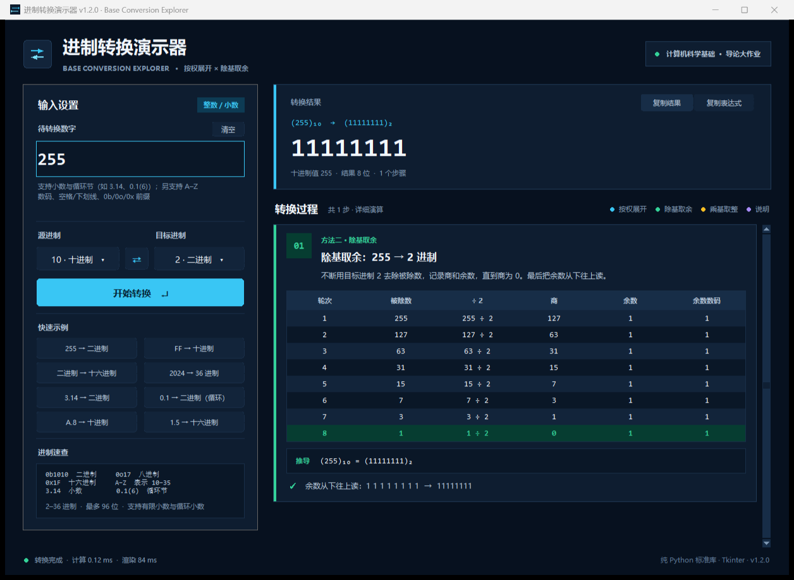
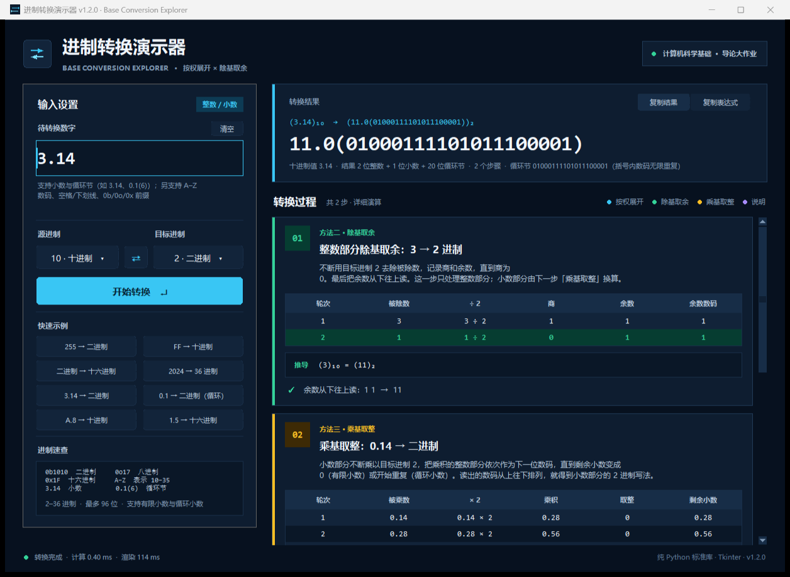
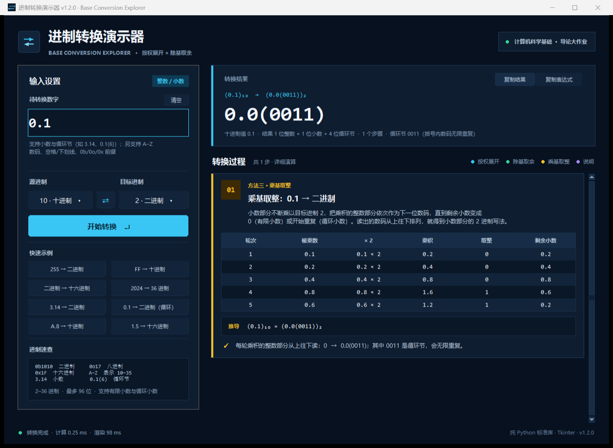
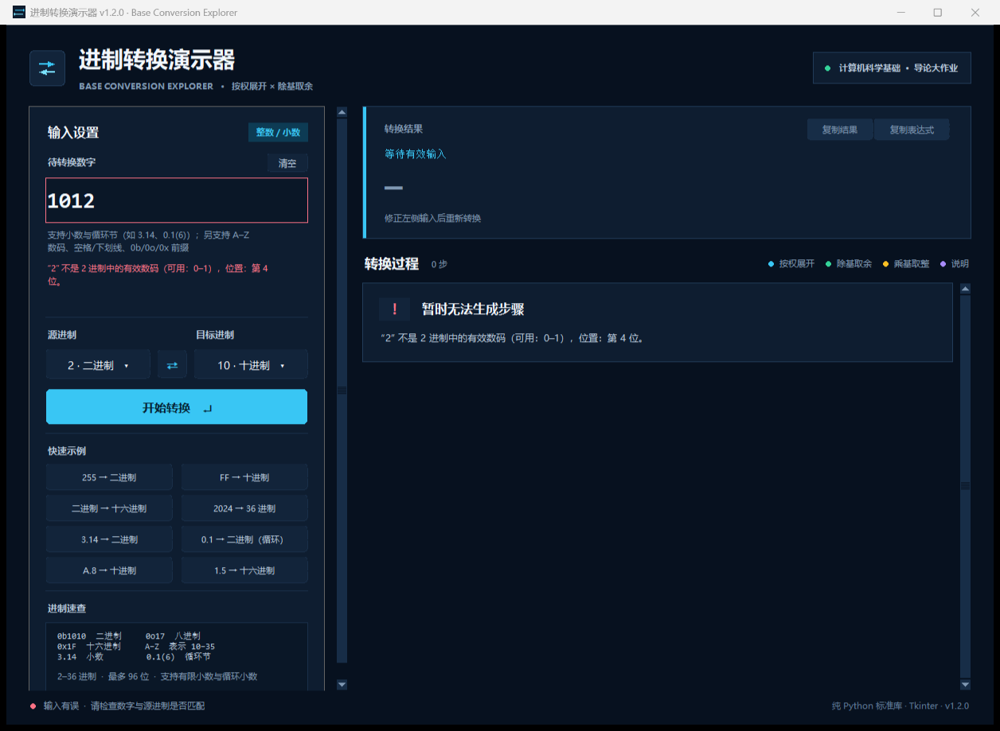
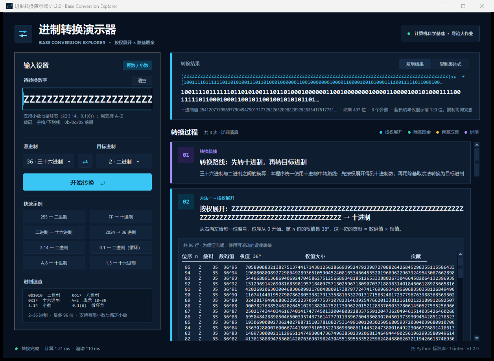

# 进制转换演示器 · Base Conversion Explorer

> 计算机科学基础导论大作业 · 进位制转换步骤可视化

一个用 **Python + Tkinter** 编写的桌面演示程序，支持 **2–36 进制**任意整数与小数互转，并把「按权展开」「除基取余」「乘基取整」的完整计算过程拆成可滚动、可讲解的步骤卡片。

当前版本为 **v1.2.0**，新增有限小数、循环小数与循环节标注，完整变更见 [CHANGELOG.md](CHANGELOG.md)。仓库内的 `进制转换演示器.exe` 已同步更新为 v1.2.0，可直接双击体验小数转换。



---

## ✨ 功能特性

| 功能            | 说明                                                                                  |
| ------------- | ----------------------------------------------------------------------------------- |
| 任意进制互转        | 源进制、目标进制均可在 2–36 之间选择，支持 A–Z 表示 10–35，大小写不敏感                                          |
| 小数与循环小数       | 支持 `3.14`、`0.1`、`A.8` 等小数，全程用有理数精确计算；循环小数用括号标注循环节，如 `(0.1)₁₀ = (0.0(0011))₂`，也支持把 `0.1(6)` 这样的循环节直接作为输入 |
| 详细步骤          | 非十进制 → 十进制展示**按权展开表**（小数位序从 −1 开始）；十进制 → 非十进制展示**除基取余表**；小数部分展示**乘基取整表**  |
| 通用路线          | 两个非十进制互转时，自动先转十进制，再转目标进制，并展示转换路线                                                    |
| 负数支持          | 负号单独保留；按权展开、除基取余与乘基取整都按**绝对值**演算，步骤标题、说明和公式会注明「绝对值」以及最后补回负号，避免与补码概念混淆               |
| 大整数与超长输入      | 基于 Python 任意精度整数与 `Fraction`，**整数、小数与循环节合计最多输入 96 位数码**；输出位数可以超过 96 位（例如 96 个十进制 9 会得到 319 位二进制）。超长数字自动换行或改用紧凑表格 |
| 实时预览          | 停止输入约 0.4 秒后自动更新结果；若输入非法，预览时立即显示错误卡片和红色输入框，禁用复制按钮，不保留上一次的旧结果                          |
| 全角与容错输入       | 输入先做 NFKC 规范化，全角数字、全角字母、全角空格都能识别；允许数字之间的空格与下划线；`。`、`·` 也可当小数点使用                                       |
| 前缀识别与提示       | 识别 `0b`/`0o`/`0x` 前缀，但只在与源进制匹配时生效；不匹配时会明确提示切换源进制或去掉前缀                                |
| 便捷操作          | 交换源/目标进制、复制结果、复制表达式、8 组快捷示例（含小数与循环小数）                                                          |
| 清空            | 「清空」按钮或 `Esc` 可一键清空输入、结果和步骤，输入框下方会提示可用的输入格式                                          |
| 自由选择进制        | 点击源/目标进制按钮，弹出 2–36 进制选择面板，所有进制都有中文名称（如十七进制 … 三十六进制）                                  |
| 适配小屏与滚动布局     | 默认窗口 1240×880，会按桌面可用区域自动缩小（最小约 1000×640）；左侧输入区与右侧步骤区均可滚动，Windows/Linux 下支持鼠标滚轮，1366×768 等小屏不再裁切内容               |
| 键盘焦点          | 转换、复制、交换、选择进制后焦点都会回到输入框；Canvas 按钮有可见的焦点环，复制按钮也会进入 Tab 顺序                             |
| 超长输入不卡顿       | 步骤超过 40 行或窗口较窄时，改用单个只读 `Text` 呈现可滚动紧凑表格；96 位三十六进制 → 二进制的极端场景实测通常 1 秒内完成             |
| 友好报错          | 非法数码会指出该进制允许的数码范围，以及它在**原始输入文本**中的位置                                                 |
| 开箱即用          | 提供 Windows 64 位可执行程序（v1.2.0，已支持小数与循环小数），目标电脑无需安装 Python                                                  |
| 零第三方依赖        | 源码只使用 Python 标准库；EXE 已内置 Python/Tk 运行库                                              |

---

## 🚀 快速开始

### 启动方式（推荐：直接运行 EXE）

双击项目根目录的 **`进制转换演示器.exe`**（当前版本 v1.2.0，已支持小数）即可启动，**不需要安装 Python**。

> `进制转换演示器.exe` 必须与同目录下的 `_internal` 文件夹一起使用，请勿只复制 exe。
> 程序未做商业代码签名，首次运行时如果 Windows SmartScreen 提示“已保护你的电脑”，
> 点击“更多信息”→“仍要运行”即可。

### 源码运行（开发调试）

环境要求：Python **3.10+**，Tkinter 默认包含在 Windows 官方 Python 中；无第三方依赖。

```bash
py main.py
```

也可以双击 `run.bat`。如果系统没有 `py` 启动器，改用 `python main.py`。
Linux 如缺少 Tkinter，可先安装 `sudo apt install python3-tk`。

> **小屏提示**：程序启动时会根据桌面可用区域自动调整窗口大小。只要可用桌面区域不小于约 1000×640（例如 1366×768、1024×768 的常见投影环境），左侧输入区可以滚动查看全部设置，右侧结果与步骤区也可独立滚动。

> **高 DPI 说明**：从源码运行时，Windows 上使用系统级 DPI 感知（`SetProcessDpiAwareness(1)`）；打包后的 EXE 通过 manifest 声明 PerMonitorV2。界面缩放会自适应，最高放大到 2.0 倍，高 DPI 屏幕上窗口最多放大约 1.35 倍，避免 4K 屏上字太小。

---

## 📖 使用说明

1. 在左侧输入框中输入整数或小数，例如 `255`、`FF`、`1010`、`3.14`、`0.1`。
2. 点击「源进制」或「目标进制」按钮，在弹出的 2–36 进制面板中选择进制，按钮上会显示当前选择的进制与中文名称。
3. 输入过程中会自动预览；点击「开始转换」或按 `Enter` 可立即生成完整的步骤卡片。整数部分展示「除基取余」，小数部分展示「乘基取整」；循环小数会在结果和步骤中用括号标出循环节。
4. 点击「⇄」交换两种进制：输入有效时，程序会把当前结果带回输入框，方便验证往返转换（循环小数也可以直接参与反向转换）。
5. 点击「复制结果」复制目标进制数字；点击「复制表达式」复制形如 `(255)₁₀ → (FF)₁₆` 的完整表达式。复制后的状态提示遇到超长内容会自动截断。
6. 点击「清空」或按 `Esc`（输入框获得焦点且内容非空时）清空输入、结果和步骤。
7. 点击 8 个快捷示例可快速切换演示场景，包括整数示例 `255 → 二进制`、`FF → 十进制`、`二进制 → 十六进制`、`2024 → 36 进制`，以及小数示例 `3.14 → 二进制`、`0.1 → 二进制（循环）`、`A.8 → 十进制`、`1.5 → 十六进制`。
8. 修改输入、切换进制后，焦点会自动回到输入框，可以继续输入或直接按 `Enter`。

### 快捷键

| 按键              | 功能                | 作用范围                                   |
| --------------- | ----------------- | -------------------------------------- |
| `Enter`         | 开始转换              | 程序窗口内全局生效；进制选择面板打开时由面板处理              |
| `F5`            | 重新转换              | 与 `Enter` 相同                           |
| `Ctrl + A`      | 全选输入框内容           | 输入框获得焦点时                              |
| `Ctrl + Shift + C` | 复制表达式            | 有转换结果时                                |
| `Esc`           | 清空输入、结果与步骤        | 输入框获得焦点且内容非空时                         |

进制选择面板也支持键盘：`Enter` / `F5` 确认当前进制并重新转换，`Esc` 关闭面板并把焦点交还按钮。

### 输入规则

- 支持 2–36 进制；0–9 表示 0–9，A–Z 表示 10–35，字母大小写等价。
- 数字可以带正负号，例如 `-255`、`+1010`。
- 允许前后空格、数字之间的空格与下划线，例如 `1010 1010`、`FF_FF`。
- 支持全角字符：`２５５`、`０ｘ１Ｆ`、全角空格和全角正负号会先经 NFKC 规范化再解析。
- 允许与源进制匹配的前缀：`0b1010`、`0o17`、`0x1F`。如果前缀与源进制不匹配，程序会提示，例如在十进制下输入 `0x1F` 会提示“检测到 0x 前缀（十六进制），但当前源进制是 十进制；请把源进制改为 16，或去掉前缀。”
- 支持小数：`3.14`、`.5`、`-0.625`；小数点可以用 `.`、全角 `．`、中文句号 `。` 或间隔号 `·`。
- 支持循环节：用一对括号把无限重复的数码括起来，例如 `0.(3)` 表示 0.333…，`0.1(6)` 表示 0.1666…。程序换算出的循环小数也会用同样写法显示（如 `0.0(0011)`），复制后可以直接粘贴回输入框做反向验证。
- 小数部分与整数部分都参与 96 位数码上限；循环节内的数码同样计数。
- 单次输入最多 **96 位数码**（正负号、前缀、空格、下划线、小数点和循环节括号不计入位数）。
- 错误提示中的「位置」按原始输入文本计数，空格、下划线、正负号和前缀都会计入。例如在二进制下输入 `1010 1012`，提示为“位置：第 9 位”。

---

## 🧠 算法说明

### 1. 按权展开：任意进制 → 十进制

从右往左给每一位编号，位序从 0 开始，第 `n` 位的权值是 `base^n`：

```text
(FF)₁₆ = 15 × 16¹ + 15 × 16⁰
       = 240 + 15
       = 255
```

界面上会逐行展示「位序、数码、数码值、权值、贡献」，最后给出求和结果。带小数时，小数部分从左向右编号为 −1、−2、…，第 `n` 位的权值是 `base^n`（例如二进制的 `0.101` 中，`2⁻¹ = 0.5`、`2⁻³ = 0.125`）。

**负数**：先取绝对值按权展开，步骤标题、说明和公式会明确标注「绝对值」，并在结论中说明补回负号。例如 `(-FF)₁₆ → 十进制` 的结果是 `-255`。

### 2. 除基取余：十进制 → 任意进制

不断用目标进制去除被除数，记录商与余数，直到商为 0，最后把余数**从下往上**读：

```text
255 ÷ 2 = 127 ... 1   ↑
127 ÷ 2 =  63 ... 1   │
 63 ÷ 2 =  31 ... 1   │ 从下往上读
 31 ÷ 2 =  15 ... 1   │
 15 ÷ 2 =   7 ... 1   │
  7 ÷ 2 =   3 ... 1   │
  3 ÷ 2 =   1 ... 1   │
  1 ÷ 2 =   0 ... 1   ┘
```

结果：`(255)₁₀ = (11111111)₂`。

**负数**：同样只对绝对值做除基取余，步骤中标注「绝对值」，最后补回负号，结果仍为负数。

### 3. 乘基取整：小数部分 → 任意进制

小数部分不断乘以目标进制，每次取乘积的整数部分作为下一位数码，直到剩余小数为 0（有限小数）或开始重复（循环小数）：

```text
0.625 × 2 = 1.25   → 1   ↑
0.25  × 2 = 0.5    → 0   │ 从上往下读
0.5   × 2 = 1.0    → 1   ┘

(0.625)₁₀ = (0.101)₂
```

以 `0.1` 为例，二进制展开会无限循环：

```text
0.1 × 2 = 0.2  → 0
0.2 × 2 = 0.4  → 0
0.4 × 2 = 0.8  → 0
0.8 × 2 = 1.6  → 1
0.6 × 2 = 1.2  → 1   ← 剩余小数回到 0.2，开始循环
...
(0.1)₁₀ = (0.0(0011))₂
```

程序通过记录出现过的剩余小数来精确识别循环节，不会用浮点数近似；小数部分超过 64 位时（循环节过长或有限小数很长），只展开前 64 位并用 `…` 标注。

### 4. 任意进制互转

如果源进制和目标进制都不是十进制，程序按以下路线执行：

```text
源进制数  ──按权展开──▶  十进制数  ──除基取余 + 乘基取整──▶  目标进制数
```

这正是界面中「转换路线」步骤卡片所展示的内容。

对于二进制、四进制、八进制、十六进制、三十二进制等 2 的幂进制之间的互转，理论上存在按 3 位、4 位或 5 位二进制分组的快捷换算方法。本程序为了完整展示每一步演算，仍统一使用上面的十进制中转路线，并在路线卡片中说明这一点。

---

## 🖥️ 界面导览

### 自由选择进制

点击「源进制」或「目标进制」按钮，会弹出完整的 2–36 进制选择面板。当前进制高亮显示，常用的二、八、十、十六进制有颜色提示，点击任意一项即可切换。一个面板打开时，直接点击另一个进制按钮也能一步切换过去。


### 十六进制 → 二进制：三步演示


1. **转换路线**：说明为什么先转十进制，以及 2 的幂进制之间还有分组速算这一知识点。
2. **按权展开**：把 `FF` 展开成 `255`。
3. **除基取余**：把 `255` 转成 `11111111`。

每张步骤卡片都有颜色标识：**青色**表示按权展开，绿色表示除基取余，**琥珀色**表示乘基取整，紫色表示方法说明。

### 小数与循环小数：整数、小数分开演示



输入 `3.14` 并转换为二进制时，结果卡会给出精确的循环小数 `11.0(01000111101011100001)`，步骤区分为「整数部分除基取余」和「小数部分乘基取整」两张卡片。



输入 `0.1` 会得到 `0.0(0011)`，括号内就是循环节。输入 `0.1(6)` 这样的循环节写法也能直接换算，程序会先用等比级数把循环节化为精确分数，再继续转换。

结果卡下方的元信息会显示十进制值、整数/小数/循环节位数；循环节过长时，结果以 `…` 结尾并提示已截断。

### 无效输入：即时报错



输入 `1012` 且源进制为二进制时，输入框立即出现红色边框，左侧显示错误原因和位置，右侧结果卡回到「等待有效输入」状态，步骤区显示错误说明，复制按钮同时被禁用，不会继续展示上一次的旧结果。

### 小屏与超长输入


在 1024×700 这样的小窗口中，窗口会自动缩小，左侧输入区出现可滚动条（内容放得下时自动隐藏），转换按钮和快捷示例都能滚动查看，不再被裁切。



输入 96 位三十六进制数时，结果卡只显示前 120 位左右并用 `…` 标记，同时提示“超长结果仅显示前 120 位，复制可得完整值”；完整结果仍会复制到剪贴板。步骤区会自动改用紧凑的可滚动文本表格，保证界面不卡顿。

---

### Git 协作约定

- `main` 分支始终保持可运行；每位成员在功能分支上开发，再发起 Pull Request。
- 每个 PR 至少由另一名成员审查后合并；合并完成后删除功能分支。
- 提交信息建议采用 `feat:`、`fix:`、`docs:`、`test:`、`build:` 前缀，便于阅读提交历史。
- 建议安排一次真实的合并冲突演练：两人修改同一段文字/同一个参数，在本地解决冲突后再合并，并保留冲突解决记录。
- 当前仓库已有一个可运行的初始基线；后续成员请使用各自的 GitHub 账号提交，以便体现真实的协作记录。

更完整的模块设计、测试方案与团队表格见 [Project_Requirements_and_Design.md](Project_Requirements_and_Design.md)。

---

## 📁 项目结构

```text
进制转换演示器/
├── 进制转换演示器.exe              # 双击启动的可执行程序（Windows 64 位，v1.2.0）
├── _internal/                       # EXE 运行所需的 Python/Tk 运行库，请勿删除
├── main.py                          # 源码入口（含 Windows 高 DPI 适配与启动失败提示）
├── run.bat                          # 源码运行的一键启动脚本
├── .github/
│   └── workflows/tests.yml          # GitHub Actions：自动运行 115 个测试
├── README.md                        # 项目说明
├── CHANGELOG.md                     # 版本变更记录
├── Project_Requirements_and_Design.md  # 作业要求的需求与设计文档
├── LICENSE                          # MIT 开源协议
├── .gitignore                       # 忽略缓存、虚拟环境与打包中间产物
├── assets/
│   └── app.ico                      # 应用图标
├── base_converter/
│   ├── __init__.py                  # 包入口（惰性导入界面，方便无图形环境测试）
│   ├── converter.py                 # 核心算法与步骤生成（不依赖 UI）
│   ├── theme.py                     # 配色与字体
│   ├── widgets.py                   # 圆角按钮、滚动容器、进制选择面板等自定义控件
│   └── app.py                       # Tkinter 主界面与交互逻辑
├── build/
│   ├── BaseConverterDir.spec        # PyInstaller 打包配置（onedir + windowed）
│   ├── app.manifest                 # PerMonitorV2 DPI 感知与 Windows 兼容性声明
│   ├── version_info.txt             # EXE 文件属性版本号（1.2.0）
│   ├── build.ps1                    # 一键打包脚本
│   └── README.md                    # 打包说明
├── tests/
│   ├── test_converter.py            # 核心逻辑单元测试（106 个用例）
│   └── test_app_ui.py               # 界面回归测试（9 个用例，无显示环境自动跳过）
└── screenshots/
    ├── main.png                     # 主界面截图
    ├── decimal_mixed.png            # 小数转换：3.14 → 二进制
    ├── decimal_cycle.png            # 循环小数：0.1 → 二进制
    ├── base_picker.png              # 进制选择面板截图
    ├── hex_to_binary.png            # 多步骤演示截图
    ├── error_preview.png            # 无效输入即时报错截图
    ├── long_input.png               # 超长输入与截断显示截图
    └── small_window.png             # 小屏滚动布局截图
```

### 分层设计

- **计算与界面分离**：`converter.py` 只负责解析、计算、生成步骤数据，可在终端中独立测试；`base_converter/__init__.py` 采用惰性导入，导入核心模块时不会连带加载 Tkinter。
- **步骤数据化**：每一步被封装为 `Step`，包含标题、说明、表头、表格行、推导式和结论，界面只负责渲染。
- **统一主题与控件**：颜色、字体、间距集中在 `theme.py`；圆角按钮、滚动容器、进制选择面板集中在 `widgets.py`，方便统一调整风格。
- **可测试性**：106 个核心逻辑单元测试 + 9 个界面回归测试，覆盖进制解析、小数与循环节、非法输入、前缀、全角输入、负数步骤、大数、随机往返、实时预览、焦点与超长输入渲染等场景。
- **可复现打包**：`build/` 目录保存了 spec、manifest、版本信息和打包脚本，可在仓库内直接重新构建 EXE。

---

## 🛠️ 版本与打包

- 程序窗口标题和页脚都会显示版本号 **v1.2.0**，打包配置中的 EXE 文件属性版本号同样更新为 1.2.0。
- 仓库内的 `进制转换演示器.exe` 已更新为 v1.2.0（onedir 模式，与 `_internal/` 一起发布）；重新打包可执行下面的脚本。
- 打包需要额外安装 PyInstaller（仅构建时需要，程序运行仍为零第三方依赖）：

```powershell
py -m pip install --upgrade pyinstaller
powershell -ExecutionPolicy Bypass -File build\build.ps1
```

也可以直接执行：

```powershell
py -m PyInstaller --noconfirm --clean build/BaseConverterDir.spec
```

打包产物位于 `build/dist/BaseConverterDir/`，将 `BaseConverterDir.exe` 改名为 `进制转换演示器.exe`，并与 `_internal/` 一起复制到项目根目录即可。更多说明见 [build/README.md](build/README.md)。

---

## ✅ 运行测试

在项目根目录执行：

```bash
py -m unittest discover -s tests -v
```

共 **115 个测试**：106 个核心逻辑单元测试 + 9 个 Tkinter 界面回归测试。有图形显示环境时预期输出：

```text
Ran 115 tests in 20s 左右

OK
```

在没有图形显示的环境（如远程 CI）中，9 个界面测试会自动跳过：

```text
Ran 115 tests in 0.2s 左右

OK (skipped=9)
```

测试内容包括：

- 常见进制解析与大小写、空格、下划线、前缀、正负号、前导零处理
- NFKC 全角输入（全角数字、字母、空格、正负号、前缀、小数点）
- 小数与循环节：精确值、规范化写法、循环节括号语法、`0.(9)` 进位、截断标记与错误位置
- 有尽小数、循环小数、负数小数的双向换算与随机往返
- 前缀与源进制不匹配的明确提示
- 错误位置按原始输入文本计数（空格、下划线、符号、前缀均计入）
- 负数步骤的「绝对值」文案、同进制负号表达式、结果符号
- 2–36 进制中文名称完整性、转换路线文案、2 的幂进制分组说明
- 96/97 位输入边界、100 组随机十进制往返、50 组随机非十进制互转
- 不导入 Tkinter 即可使用核心模块（惰性导入）
- 界面：非法预览清空旧结果、Enter 只转换一次、⇄ 使用当前输入、小数循环结果的预览与交换、焦点回到输入框、复制按钮进入 Tab 顺序、清空状态、96 位输入快速渲染与结果截断

---

## ⚠️ 已知边界

- 支持有限小数与循环小数，但目标进制的小数展开最多保留 **64 位**；循环节过长或有限小数较长、64 位内没有结束时，结果以 `…` 结尾并在步骤中说明，截断后的文本不能直接作为新输入。循环节请用括号表示，如 `0.1(6)`。
- 小数与循环节均使用 `Fraction` 精确计算，不经过浮点数；`0.(9)₁₀`、`0.(1)₂` 这类值会正确进位为整数 `1`。
- 负数采用「符号 + 绝对值」表示，**不涉及补码**；补码属于另一个知识点。
- 单次输入最多 **96 位数码**（整数、小数与循环节合计）。输出位数可以超过 96 位，例如 96 个十进制 9 会转换成 319 位二进制；超长结果只显示前 120 位左右，完整值仍可复制，步骤表格会自动换行或改用可滚动的紧凑表格。
- 可用桌面区域建议不小于约 **1000×640**；1366×768、1024×768 等小屏会自动缩小窗口并可滚动，不再裁切内容。默认窗口尺寸为 1240×880。
- 高 DPI 屏幕下界面会自动缩放（最高 2.0 倍），EXE 使用 PerMonitorV2，源码运行使用系统级 DPI 感知。
- 程序运行不需要任何第三方库；仅重新打包 EXE 时需要 PyInstaller。

---

## 📄 开源协议

本项目使用 [MIT License](LICENSE) 开源。

需求分析、模块划分、算法与团队分工表见 [Project_Requirements_and_Design.md](Project_Requirements_and_Design.md)，版本变更见 [CHANGELOG.md](CHANGELOG.md)。

如果这个项目对你的课程学习有帮助，欢迎在仓库中保留出处并自由修改。
